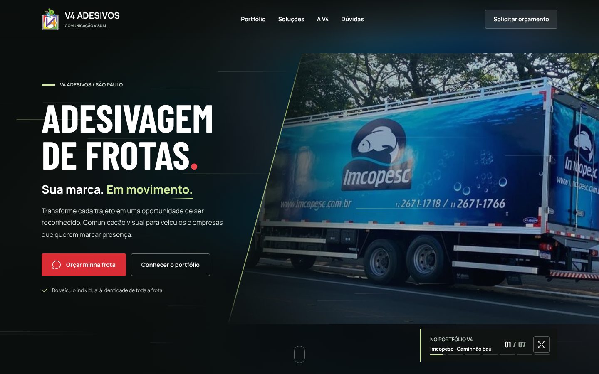
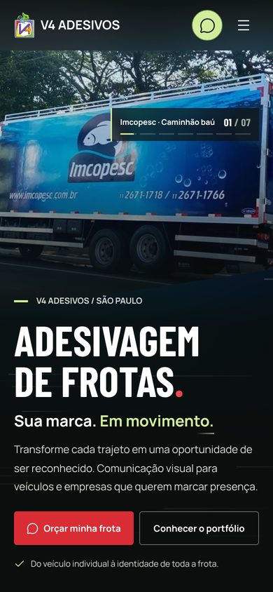

# V4 Adesivos — Prévia do site

Prévia do novo site da V4 Adesivos: adesivação de frotas, envelopamento automotivo e ambientação comercial.
Preview of the new website for V4 Adesivos, a company that does fleet graphics, vehicle wraps and commercial interior graphics.

[🇧🇷 Português](#-português) · [🇺🇸 English](#-english)

  
  

---

## 🇧🇷 Português

Site estático, sem dependências externas de execução. Rode `node scripts/build.cjs` para gerar a pasta `dist/` e abra `dist/index.html` (ou abra direto `public/index.html`). Não é necessário instalar um servidor para visualizar os arquivos locais.

> ℹ️ A pasta `dist/` não vai para o Git: ela é gerada a partir de `public/` pelo `scripts/build.cjs`.

### Organização

- `public/index.html`: conteúdo, metadados e dados estruturados.
- `public/styles.css`: identidade visual, layouts e responsividade.
- `public/app.js`: portfólio, menu, serviços, formulário, eventos e animações.
- `public/animacoes.css` e `public/animacoes.js`: topo em tela cheia (carrossel de trabalhos com efeito de adesivo sendo aplicado, linhas de velocidade e entrada animada) e animações de rolagem do restante do site. Respeitam `prefers-reduced-motion`; se o script falhar, o conteúdo aparece sozinho após 3 s.
- `public/icons.js`: subconjunto dos ícones Lucide (licença ISC).
- `public/images/portfolio/`: originais e WebP otimizados.
- `public/fonts/`: fontes Barlow Condensed e Manrope, obtidas do Google Fonts (SIL Open Font License).
- `dist/`: versão publicada, sem os JPG originais.
- `IMAGENS.md`: origem, resolução e aplicação das fotos.
- `FONTES_E_PENDENCIAS.md`: fontes de informações e pendências.
- `TRATAMENTO_IMAGENS.md`: orientação para eventual tratamento autorizado, não executado.

### Preparar a publicação

Execute `node scripts/build.cjs` depois de editar `public/`. A hospedagem usa `.openai/hosting.json` e preserva o mesmo projeto privado. O número do WhatsApp fica em `public/app.js`.

Não há envio automático de mensagens. Os CTAs abrem a conversa; o visitante confirma o envio no WhatsApp. O formulário não grava dados em um servidor. `dataLayer` não recebe nome, empresa, cidade nem mensagem do visitante.

### Validação

Navegador real Edge via Playwright: 36 fotos, nove filtros (oito categorias e Todos), ampliação, navegação por teclado, filtros, serviços, FAQ, formulário, mensagens com acentuação e caracteres especiais, menu e Escape. Larguras: 320, 390, 768, 1280 e 1920 px.

As mensagens foram interceptadas durante o teste, sem contato com a empresa. Auditoria axe-core WCAG 2 A/AA e 2.1 AA em desktop e mobile. Os JSON e capturas entregues registram os resultados. A auditoria automatizada não substitui uma avaliação manual integral de acessibilidade.

Medições locais de LCP e CLS são testes de laboratório, sem limitação de CPU ou rede. Não representam dados reais de Core Web Vitals de visitantes ou resultados do PageSpeed na hospedagem.

---

## 🇺🇸 English

A premium demo website for V4 Adesivos. It's a static site with no external runtime dependencies. Run `node scripts/build.cjs` to generate `dist/`, then open `dist/index.html` (or open `public/index.html` directly). The `dist/` folder is not committed; it's built from `public/`.

### Highlights

- A filterable **portfolio** with 36 real photos in 8 categories (small cars, vans, Kombis, pickups, box trucks, ambulances, vehicle wraps and commercial interiors), with zoom and keyboard navigation.
- A full-screen hero carousel with a "sticker being applied" effect and speed lines.
- Services, FAQ and a quote form that opens a pre-filled WhatsApp conversation (nothing is sent to a server).
- Respects `prefers-reduced-motion`; if the script fails, content shows up on its own after 3 s.

### Project structure

- `public/`: the source (HTML, CSS, JS, icons, fonts and original + optimized images).
- `dist/`: the published version (generated, not committed), without the original JPGs.
- `scripts/build.cjs`: copies `public/` into `dist/`.
- `IMAGENS.md`, `FONTES_E_PENDENCIAS.md`, `TRATAMENTO_IMAGENS.md`: image sources, information sources and open items.

### Building

Run `node scripts/build.cjs` after editing `public/`. The WhatsApp number lives in `public/app.js`.

### Validation

Tested in a real browser (Edge via Playwright) at 320, 390, 768, 1280 and 1920 px, plus an axe-core WCAG 2.1 AA audit on desktop and mobile.
